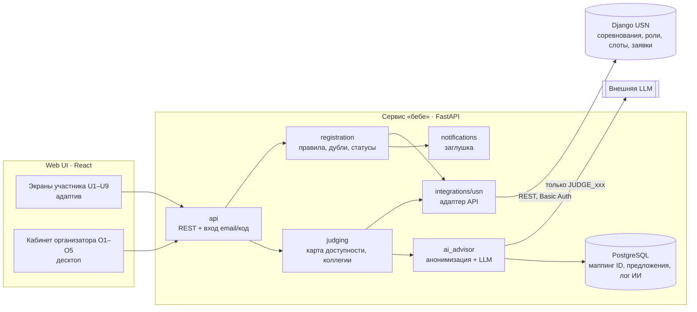

# Архитектура

**Паттерн:** модульный монолит (FastAPI) + React; интеграция с системой заказчика через адаптер
(порты и адаптеры). Почему: одна команда, один деплой, низкая нагрузка (до ~50 соревнований в год),
нельзя менять Django заказчика — изменения его API изолированы в одном модуле.

## Компоненты
| Модуль | Ответственность |
|---|---|
| `api` | эндпоинты для UI, вход участников по email + код (в API USN авторизации нет) |
| `registration` | правила ролей и форматов, поиск существующей заявки, статусы |
| `judging` | карта доступности (блоки ≠ поединки), подбор коллегий, поиск дефицита |
| `ai_advisor` | анонимизация ПДн, объяснения, варианты закрытия дефицита, тексты приглашений |
| `integrations/usn` | единственная точка обращения к API USN (mock / http) |
| `notifications` | интерфейс для писем (код входа, «заявка принята»), задел под рассылки |

## Данные
Заявки и статусы — в системе заказчика (через API). У нас — только производные данные:
маппинг анонимизации, предложения коллегий, лог ИИ, сессии.

## Критический сценарий
Заявка судьи → пересчёт карты доступности → предложение коллегий с объяснением → организатор утверждает.
